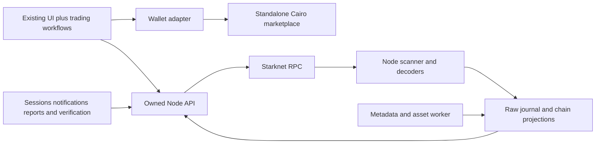

# Starknet marketplace — full scope and build plan

Version 1.1 · 7 October 2026

**Start here.** This is the consolidated project plan. It joins the contract, indexer, API, existing frontend, OpenSea product benchmark, operations and migration into one delivery sequence. It supersedes earlier launch-boundary statements where they differ; supporting documents provide implementation detail and historical evidence.

Status: implementation in progress. **Deployment is blocked by remaining dependency advisories and the launch gates below.** Standalone Cairo settlement, the native Node indexer/API and retained-UI trading flows are implemented locally; integration and acceptance work is ongoing. No production deployment, independent audit, production backfill or staging soak is claimed. Track milestone completion here; supporting designs do not maintain competing status lists.

## 1. Product outcome

Build an OpenSea-quality NFT marketplace for the initial Starknet/Realms collection set: discover assets, understand the market, list and reprice inventory, buy/sweep, make and accept bids, manage orders, and follow trading activity.

Keep the current UI's visual design and reusable components. Extend it for the missing workflows. Build standalone Cairo settlement and an owned Node.js indexing/API backend. The new marketplace must operate without Torii, Dojo World storage, Cartridge-hosted market data or Arcade SDK trading logic.

OpenSea is the NFT product benchmark, not a claim of exhaustive feature parity. The concrete release checklist below defines completion.

## 2. Decisions and remaining choices

| Item | Plan |
| --- | --- |
| UI | Retain Next.js, existing visual system, routes and reusable components |
| Settlement | New standalone Cairo contract; direct storage and explicit events |
| Order creation | On-chain, confirmed by user |
| Core assets/actions | ERC-721 listings, token offers, atomic single-currency cart, confirmed by user |
| Indexing | Our own Node.js implementation; direct configurable Starknet RPC |
| Backend dependencies | Zero third-party runtime packages as the conservative interpretation of “no deps”; Node built-ins |
| OpenSea launch expansion | Include collection offers, bulk seller workflows, trader dashboard, search/analytics, trust tools and in-product notifications in this consolidated target plan |
| Collection offers | One-shot offers for any NFT in a specified collection; no partial fills. Implemented in the version-1 ABI |
| Data scope | Curated launch collection registry; operator-led onboarding |
| Backend storage | Implemented SQLite/local persistent storage with one writer per chain and off-host backups |
| Pricing | Confirmed fixed buyer debit, fees/royalties deducted from that total; no executor surcharge |
| Royalties | Confirmed snapshots for token-specific orders; bounded fill-time royalties for collection offers |
| Administration | Confirmed non-upgradeable contract, limited multisig administration, cancellation available while paused |
| Hosting | Portable deployment; provider, operator, capacity and budget still to select |

User confirmed inclusive buyer pricing, token-order royalty snapshots, capped fill-time collection royalties and a non-upgradeable contract with limited administration on 6 October 2026. The implementation caps protocol fees at 500 basis points; the production rate, receiver, administrator addresses and approved asset registry remain explicit deployment inputs. These are material decisions, not numbers to invent during deployment. The broader product target does not change the user's selection of on-chain orders or ERC-721-only launch.

## 3. Launch scope

| Workstream | Launch deliverables | Completion evidence |
| --- | --- | --- |
| Trading contracts | Listing, token offer, one-shot collection offer, cancellation, bounded bulk cancellation, fill, accept offer, atomic cart | Contract invariants, malicious-callback tests, fork tests and independent review |
| Seller tools | Inventory selection, bulk list, cancel, cancel-and-relist/reprice, fee/proceeds preview | Complete wallet-to-indexed-result flows |
| Buyer tools | Listing purchase, filter-aware sweep, cart, token/collection bid, funding/approval checks | Correct totals, usable bid selection and atomic transaction tests |
| Order management | My listings; offers made/received; active, expired, cancelled, filled and currently unavailable states | Ownership-aware account feeds, pagination and action tests |
| Discovery | Collection/NFT/address search; full-collection filtering/sorting; token details; existing game-specific traits | Search/filter fixtures, later-page matches and large-ID tests |
| Market information | Current floor/top executable bid by currency, recent sales, declared-period volume/counts, price/floor history | Defined metrics reconciled to fill events |
| Portfolio | Holdings, collection filters and purchased/sold activity | Balances reconcile and confirmed changes become visible |
| Notifications | In-product offer/sale/order-change inbox and unread state | Authenticated ownership, deduplication and reorg correction tests |
| Collection operations | Register/backfill/reconcile/publish; verified-address/name policy; metadata refresh | Operator onboarding rehearsal |
| Trust/content | Report submission, review queue, content visibility controls and decision history | Authorization tests and a documented operating policy |
| Assets | Owned metadata/image delivery, dynamic trait refresh and explicit failure states | Coverage report and stale/failure behavior |
| Operations | Metrics, alerts, RPC failover, backup/restore, replay and rollout | Recovery/load/soak evidence and named operator |
| Migration | New approvals/orders; clear separation from Arcade; bounded legacy cancellation/history decision | Rehearsed cutover with no unauthorized order recreation |

Preserve single-currency checkout and maximum 25 NFTs. Across approved currencies, do not compare raw amounts as if they share value. Portfolio and search cover indexed registered collections; arbitrary all-Starknet discovery is not implicitly included.

### Follow-up releases

Trait/criteria offers, private/reserved listings, watchlists and richer profiles, email/push notifications, portfolio NFT transfers, permissionless collection onboarding, ERC-1155/partial fills, signed gasless orders, auctions and bundles are outside this launch plan. Prioritize them by demonstrated demand.

Trait offers need a separate decision about fixed token-set membership versus live on-chain predicates, particularly for mutable game attributes. A backend trait match cannot authorize spending. Features that change immutable contract semantics may require another deployment; do not pretend they are merely frontend additions.

## 4. Architecture and ownership

- **Contract:** authoritative order authorization, exact settlement, cancellation, pause and supported-asset policy. No backend trust for execution.
- **Indexer:** canonical events, ownership/approval projections, terminal order state, progress and recovery.
- **API:** filtering, summaries, account queries, consistent pagination/provenance and advisory preflight.
- **Application data:** sessions, notifications, reports and verification decisions. These cannot be regenerated from chain events and need separate backups/migrations.
- **Frontend:** user intent, wallet signing, clear totals/errors and transaction/index progress. It cannot silently mutate order terms.

Use a single backend codebase with separate writer, API and metadata processes. No required external queue or search service at launch. Preserve a clean product interface so later storage changes do not rewrite the UI. Cairo compiler/test tooling and proposed reviewed contract primitives are distinct from the zero-package Node runtime constraint.

### Reusable marketplace packages — extraction map, 7 October 2026

Status: implemented locally as private 0.1.0 workspace packages; not published. The existing Next.js app stays in place and consumes public package exports through retained view-model/wallet adapters. TanStack Query was explicitly selected by the user for fetching; Query Core is the SDK runtime dependency and React Query powers the optional React bindings. The backend package remains independently deployed.

**Package structure**:

- `packages/marketplace-sdk` → `@biblio/marketplace`: framework-independent TypeScript, ESM plus declarations, explicit exports and TanStack Query Core as its runtime dependency. Runs in modern browsers and Node without importing Next.js, React, Zustand, wallet connectors or SQLite. Owns typed reads, order preparation, amount/identity invariants, approval planning, transaction lifecycle and recovery. Ships versioned contract ABI assets and protocol compatibility checks. The ABI export remains generated from the Cairo contract rather than maintained by hand.
- `packages/marketplace-react` → `@biblio/marketplace-react`: optional provider, query hooks, action hooks and reactive transaction state over the SDK. React and TanStack Query are peer dependencies. Wallet integration is an explicit adapter; the core SDK does not choose, connect or install a wallet. The main app supplies the reference Starknet React wallet adapter; wallet-specific dependencies stay outside the published SDK.
- `services/marketplace-backend`: remains a separately operated indexer/API. A consumer supplies its own compatible endpoint or uses an explicitly configured shared deployment. Installing the SDK does not run an indexer or remove the need for indexed data. Operator credentials, journal/storage, scanners, metadata workers and server signature verification remain server-side.
- Main app: imports the packages using `workspace:*`. Owns routes, shadcn/Tailwind rendering, brand assets, collection/game presentation, wallet chooser, URL state and cart drawer. Cart selection/validation and transaction rules come from the SDK; drawer visibility and messages remain presentation concerns. Storybook uses the same public package interfaces with fixture adapters.

**Source-to-package map**:

| Existing implementation | Destination / treatment |
| --- | --- |
| `src/lib/marketplace/api-client.ts`, domain types and API read logic | SDK typed client; inject endpoint, network, fetch and request policy. Replace app environment reads and fixed localhost paths. Keep legacy view-model conversions private to app migration. |
| `write-adapter.ts`, amount/royalty/order identity helpers, ABI | SDK protocol internals and deliberately exported advanced call builders; exact bigint arithmetic and explicit currency metadata |
| Checkout in `cart-sidebar.tsx`, creation/repricing in `order-composer.tsx`, acceptance in `accept-offer.tsx`, cancellation in `trader-dashboard.tsx` | SDK semantic trade preparation methods; remove duplicated business logic from views |
| `use-trade.ts`, `pending-transaction.ts` | Framework-independent transaction coordinator with account, receipt, storage and clock adapters; React subscribes to it |
| `react.tsx`, `hooks.ts`, query helpers | React package using SDK reads and instance-scoped query keys |
| `use-wallet-session.ts` | SDK challenge/verification requests and injected signing; React binding. Server verification stays in backend. |
| Cart store and listing utilities | Pure cart constraints/candidate selection in SDK; optional instance-scoped React state adapter; persistence supplied explicitly |
| `seo-data.ts` | App-specific metadata construction using the SDK server client |
| Realms images, game filters, wallet chooser, components and route shells | Remain app-owned; reusable branded UI is a separate future deliverable |

**Public interface**:

1. `createMarketplaceClient({ apiUrl, chain, chainId, expectedMarketplace, fetch?, queryClient?, headers?, credentials?, timeoutMs?, assetBaseUrl? })` creates an isolated client. Read-only use needs no wallet. Trading requires a pinned expected deployment and compatible API/contract versions. Currency metadata, cache identity and pending records are scoped to the client/deployment; no shared mutable currency maps, global transaction store or implicit browser storage.
2. Typed read groups cover collections/tokens/traits, listings/orders/offers, search, account holdings/orders/activity, statistics/best bid, configuration/status and transaction reflection. Expose cursor pagination, query cancellation and structured errors. Do not silently fetch all pages, round chain values or convert failures into empty results.
3. `trades.prepareListing`, `prepareTokenOffer`, `prepareCollectionOffer`, `prepareBuy`, `prepareAcceptOffer`, `prepareCancel` and `prepareReprice` accept domain intent and account identity. Bulk input reuses these methods and preserves current limits. Preparation returns reviewable terms, approval requirements, calls, per-item failures, freshness and account/deployment binding. Distinguish exact settlement quotes from estimates/caps. Preflight remains advisory.
4. `trades.submit(prepared, accountAdapter)` validates binding, expiry, current account/network and reviewed payment/proceeds bounds before requesting a signature. A refresh that changes reviewed terms requires a new review; never silently expand an approval or payment. Signing is an explicit action, never an effect of mounting a hook or fetching data. Low-level calldata builders remain an advanced escape hatch with clearly documented caller responsibilities.
5. Submission returns a transaction handle/hash separately from receipt acceptance and index reflection. `transactions.watch` / `resume` expose typed progress and recover retained records without resubmission. Scope concurrency by account and deployment; coordinate consumers of the same client. Document that separate tabs/processes require a shared coordination adapter if cross-context locking is desired. Unknown submission outcomes must not be retried automatically.
6. Authentication supports public reads without a session and explicit wallet verification for inbox/report actions. Same-origin proxy is the default app integration. Cross-origin integration requires a deliberate backend origin/cookie policy or a compatible BFF; do not assume the current session cookies work on arbitrary domains. Server clients use per-request credentials, never a global user session. Keep operator operations out of the browser package.

**Migration sequence**:

1. Inventory every marketplace read/write call site and freeze existing behaviour with public-interface tests. Record ABI/API versions and exported types; do not expose legacy Dojo/project configuration as new SDK concepts.
2. Create workspace packages, build/type/export configuration and packed-artifact checks. Start private; publication is a separate release decision.
3. Extract protocol types, exact amounts, identity, ABI and the injected HTTP client. Migrate app reads and SSR reads first; app wrappers may temporarily preserve view models but must delegate to the SDK.
4. Extract semantic order preparation and the transaction coordinator. Migrate listing, offers, acceptance, buy/cart, cancellation, bulk repricing and recovery one workflow at a time. Delete the superseded app business logic after each migration.
5. Add the React provider/hooks and wallet adapter. Migrate all app call sites and Storybook fixtures. Any changed UI follows the mandatory Storybook-first responsive workflow.
6. Add a minimal non-React consumer and a minimal React consumer that install packed packages without `@/` aliases or repository source imports. Prove reads and a devnet trading journey from both.
7. Run app regression/Storybook tests, native API compatibility tests and devnet contract/indexer reconciliation through the public SDK. Produce migration and integration documentation. Only then call the main app an SDK consumer and consider publication.

**Extraction acceptance gates**: package imports have no app/env/DOM side effects; two clients with different deployments/currencies are isolated; account/network changes invalidate prepared intent; stale/rejected/reverted/unknown transactions cannot trigger automatic duplicate submissions; 25-item atomic single-currency checkout and cancellation during pause remain intact; packed artifacts contain declarations and ABI assets; browser and Node imports work independently; all app reads and business-level writes use public package exports; no private deep imports or parallel implementations remain. Retain existing coverage thresholds and test through the interface third-party apps actually consume. Package extraction does not satisfy the outstanding real-wallet, historical-indexing or production launch gates below.

## 5. Contract design to freeze at M0

Use `(maker, maker_nonce)` within a deployment, with full external identity including chain and marketplace address. Terms never mutate; repricing cancels and creates a new order. Each ERC-721 order fills once, quantity one.

Order kinds: `listing`, `token_offer`, `collection_offer`. Token ID is required for the first two and absent for the last; never overload a valid token ID as a wildcard. Collection-offer fill accepts one eligible NFT from the exact committed collection and consumes the order completely.

The buyer commits total debit `P`. Protocol fee `F` and royalty `R` are deducted: seller proceeds are `P - F - R`. No caller chooses an additional fee against another account. Rounding, recipient aliases, uint256 overflow and positive seller proceeds are explicit invariants.

For collection offers, commit collection, currency, total debit, expiry and maximum royalty amount. Resolve selected-token royalty at fill within that cap; the accepting seller passes minimum proceeds. This extension supersedes the token-known-at-creation assumption for that order kind only. Validate policy against supported NFT contracts before implementation.

Implemented entrypoints: create listing/token offer/collection offer; cancel one/many; buy one/many; accept token/collection offer; get order/config; bounded administration. Use existing account multicall for bulk creation and repricing first; add dedicated batch creation only if measurements justify it.

Events: initialization/configuration, complete order creation, cancellation, fill with exact economic allocations, trading switches, asset-policy changes and administrator transfer. They must reconstruct new-market state without an external orderbook or generic model engine.

Cross-reference [contract scope](./CONTRACT-SCOPE.md) for settlement guarantees and the token-specific/collection-offer confirmed royalty policies.

## 6. Backend deliverables

### Indexing

Bounded RPC event scanning, full continuation handling, receipt-derived event identity/order, pinned block/hash windows, raw journal, deterministic decoders, atomic block projections/checkpoints, per-stream progress, reorg undo/replay and schema-versioned rebuilds. Never report the fastest stream as proof every required collection is caught up.

NFT backfill starts at verified historical collection blocks. New trading history starts at our deployment. No legacy World decoder is a prerequisite for launching the new market.

### Public product API

Retain the base `/v1/chains/{chain}` interface. Provide collections, tokens, traits, orders/listings, collection offers, token/account activity, holdings, market configuration, batch order lookup, index status and checkout preflight. Add:

- Global collection/NFT/address search.
- Account order feeds filtered by made/received/listed and state.
- Collection statistics and time series by currency and declared interval.
- Best executable bid queries for a token, comparing seller proceeds when token and collection offers compete.
- Authenticated notification inbox/read state and report submission.
- Private operator interfaces for registry/onboarding, refresh, verification and content decisions.

Every candidate bid includes validation freshness. Incoming offers follow current NFT ownership. Unknown funding/approval is not a guaranteed executable offer. APIs return decimal strings for large values and stable, bounded, query-scoped cursors.

### Metadata and owned application data

Persist metadata jobs, URI/content versions and fetch status; bound unsafe destinations, redirects, sizes and retries. Failed images do not stop trade indexing. Dynamic game eligibility has its own freshness/authoritative-check policy.

Wallet-authenticated sessions use expiring, single-use, domain-bound challenges with independently verified signature/message encoding. Do not trust a client-supplied message hash or treat a public address lookup as authentication. Test supported wallet signature behavior before choosing the exact native implementation. Operator access uses separately managed credentials/roles.

Keep durable application data separate from replayable chain projections, whether in separate SQLite files or explicitly managed schemas. Notification generation is idempotent by canonical event and recipient. A reorg can invalidate an alert; unread state and user reports must not be erased by replay.

## 7. Frontend work while retaining the UI

| Surface | Changes |
| --- | --- |
| Home/discovery | Real indexed search, useful collection metrics and honest featured/trending labels |
| Collection | Full-dataset filters/sort, current listings and bids, collection-offer action, charts and sweep selection |
| Token | Exact total/proceeds, token and matching collection offers, history and safe acceptance |
| Portfolio/trader dashboard | Inventory, bulk actions, my listings, offers made/received and trade activity |
| Cart | One-currency selection, exact total, per-row failures, new `buy_many` calldata and limit checks |
| Notifications | Wallet-owned inbox, read state, links to actionable orders/tokens |
| Collection trust/reporting | Verified-address display, reporting entrypoint, restricted-content behavior |
| Ops | Real index/API progress, collection readiness and action-oriented operator diagnostics |
| SEO | Owned server-side reads and images with unavailable/stale fallbacks |

Persist submitted transaction identity. Distinguish wallet rejection, submission, acceptance/reversion and index reflection. Never invite duplicate submission because indexing is slow. Migrate persisted cart identities explicitly; invalidate incompatible old rows with an explanation.

## 8. Build sequence and gates

Roles below are responsibilities, not a claim that people have been assigned.

| Milestone | Concrete work | Depends on | Exit gate | Lead responsibility |
| --- | --- | --- | --- | --- |
| **M0 — freeze product/protocol contract** | Confirm fee/royalty/admin choices; collection-offer semantics; launch asset registry; ABI/events; expected accounting fixtures | Current plan | Reviewed interface, test matrix, dependencies and open decisions recorded | Product + Cairo |
| **M1 — reference settlement** | Test-first create/cancel/fill for listing, token offer and collection offer; explicit events; direct reads | M0 | Authorization, exact debit, expiry, pause cancellation, duplicate fill and callback tests pass | Cairo |
| **M2 — vertical slice** | One ERC-721, native RPC scanner/journal/projection, basic API and UI wallet adapter on devnet | M1 event fixtures | List → buy; offer → accept; cancel → reflected state; restart and replay agree with contract | Backend + frontend |
| **M3 — full indexing/data API** | All launch collection backfills; metadata; query/filter/holdings/account feeds; search; reorg recovery | M2 | Collection matrix and fixed-checkpoint reconciliation; no hosted reads | Backend |
| **M4 — cart and contract optimization** | `buy_many`; account bulk create/reprice/cancel; malicious asset cases; resource benchmarks | M1 | Atomic worst-case 25-item cart fits practical limits; no invariant regressions | Cairo |
| **M5 — complete trading product** | Seller/buyer dashboard, token and collection bids, sweep/cart, exact fee displays, new IDs and SEO | M2; final gate needs M3/M4 | Buyer/seller journeys pass with supported wallets, including failures | Frontend |
| **M6 — market/trust features** | Statistics/history, top executable bid, operator onboarding, authenticated inbox and reports | M3 + session design | Metrics reconcile; auth/content/notification acceptance tests pass | Backend + frontend + operator |
| **M7 — review and production readiness** | Independent contract review/fixes; fork tests; RPC/load/restore/failover; deployment configuration and class verification | M1/M4 interface frozen; final gate needs M3–M6 | Resolved review findings; green CI; rehearsed recovery; named operator | Cairo reviewer + platform |
| **M8 — migration and controlled launch** | Legacy inventory/cancel plan; Sepolia rehearsal; final classes/registry; new spender approvals; staged release and soak | M7 | All launch journeys work against real deployment; health within agreed thresholds | Release owner |

Critical path: M0 → M1 → M2 → validated event/API integration → completed product and contract review → M8. M3 and M4 can be scheduled concurrently after M2/M1 respectively; frontend can use fixed fixtures before backend completion. Independent review can start after the contract interface and implementation stabilize, but any material later changes need review coverage.

### Current implementation status — 7 October 2026

| Area | Implemented locally | Remaining launch evidence |
| --- | --- | --- |
| Cairo | Standalone non-upgradeable v1, 17 entrypoints, listing/token/collection offers, atomic cart and limited administration | Independent audit; actual launch-asset compatibility and fork/resource checks |
| Indexer/API | Native Node/SQLite journal, replay, per-source progress, metadata, preflight, sessions, reports and notifications | Historical backfill, fixed-checkpoint external reconciliation, dynamic game policies, production load/restore/failover |
| SDK | Private workspace packages, TanStack fetching, full v1 ABI coverage, direct reads, governance and recovery | Deployment integration; packages are not published |
| UI | Owned reads/trading, wallet entry points, full-width discovery, consistent spacing, reusable Storybook components | Real supported-wallet trading/recovery; on-chain admin console is not implemented |
| Local verification | Unit, Storybook/a11y, SDK packed consumers, backend, Cairo and devnet replay suites exist; CI runs required checks | Green remote CI, Sepolia rehearsal, migration decision and seven-day soak |
| Deployment | Backend container/Compose and runbook; release-tree guard and local verification command | Final addresses/class/start block, fees/admin, reviewed registry, host/domain/RPC, operator and monitoring ownership |

Run `pnpm release:verify` for reproducible local checks. The latest preparation
results are recorded below; earlier counts and individual implementation reports
are [historical evidence](history/IMPLEMENTATION-EVIDENCE-2026-10-07.md), not current
release approval. Demo screenshots and local fixtures do not close launch gates.

### Release preparation — 7 October 2026

- Local settings remain on disk but `.env.local` is removed from source control;
  nested workspace dependencies, secrets, data and build artifacts are excluded
  from Git/Docker release contexts. CI includes the release-tree guard.
- `pnpm release:verify` pins local fixture settings and runs reproducible SDK,
  backend, Cairo, coverage, build and browser gates; actual deployments require
  a separate build with reviewed environment inputs. `pnpm release:audit` is a
  separate registry/network gate and currently fails on 19 high findings.
- Next.js/ESLint config updated to 16.3.6: production audit critical findings
  reduced from 2 to 0. Remaining wallet/transitive findings are detailed in
  [operations](OPERATIONS.md#dependency-audit--7-october-2026).
- Superseded local output is archived under `.context/archive`; dated progress
  reports are in `docs/history`. The unused Arcade-era starter shell was removed.
- Final local verification on Next.js 16.3.6: 565 unit/Storybook tests, 40 SDK
  interface tests, 34 backend tests, 14 Cairo tests (including 256 fuzz cases),
  non-fixture Cairo build, packed consumers, typecheck/lint, Storybook/Next builds
  and four browser smoke tests pass. The optional screenshot test was skipped.
  Coverage remains above unchanged 70% gates (81.97% statements, 70.67% branches,
  81.39% functions, 82.88% lines). Added release-guard tests also pass. Frozen
  lockfile validation and local documentation link checks pass.
- Compose template validates; container image build/boot remains unverified
  because the local Docker daemon did not respond. Production deployment inputs,
  remote CI, independent review, supported-wallet/fork checks, backfill, recovery,
  Sepolia rehearsal and soak remain open. No deployment or new commit was made.

### Adversarial contract review — 7 October 2026

[Review report](CONTRACT-ADVERSARIAL-REVIEW-2026-10-07.md): no high-confidence
settlement vulnerability confirmed in this pass. Added 16 tests and test-only
receiver/payment callback probes. All 30 Cairo tests pass, including 512 fuzz
cases and reentry attempts against all 14 mutating entrypoints. The 40 SDK tests
pass. Production source, ABI and both class hashes are unchanged. Actual asset
compatibility, game eligibility, supported-wallet/fork testing and independent
audit remain launch gates; this local review does not close them.

### Mainnet deployment tooling — 7 October 2026

Implemented the [staged deployment workflow](MAINNET-DEPLOYMENT.md): read-only
identity probing, artifact/source/ABI verification, deterministic UDC plans,
bounded V3 declaration/deployment, final administrator in the constructor,
atomic paused configuration, multisig call export, canonical receipt and exact
Cairo 1 calldata verification, durable submission journals, explicit recovery,
current-policy replay, and indexer/frontend environment/registry exports.
Activation evidence is collected later and bound to the original plan digest.
Mainnet sends require reviewed evidence references, the exact plan digest, a
clean matching commit, correct signer/network/classes and bounded resource fees.
References record operator approval; scripts do not independently certify audits.

Validation: 22 deployment-specific tests and all 517 unit tests pass, as do lint,
typecheck, frozen-lockfile and release-tree checks. A signed localhost devnet
0.10.0 rehearsal used separate deployer/admin accounts, declared/deployed the real
marketplace, configured it paused, exported verified handoff files, recorded an
externally signed activation with later evidence, verified canonical receipts and
policy state, and confirmed that repeating a completed deployment did not consume
another nonce. The RPC needs historical state; the rehearsal uses full archiving.

No public Sepolia or mainnet transactions were sent. Production inputs remain
blank in the examples. Mainnet audit/dependency/asset/wallet/operational gates are
unchanged. The tooling supports standard Cairo 1 account multicalls; nonstandard
multisig execution wrappers need separate integration rather than relaxed receipt
verification. Local rehearsal evidence lives under `.context/deployment-rehearsals`.

## 9. Test and optimization matrix

| Layer | Required checks |
| --- | --- |
| Contract | Maker authorization; terminal state; cancellation under pause; exact expiry; allowance/funds/ownership; exact payment; royalties; recipient aliases; reentrancy; false/reverting token calls |
| Collection offers | Correct collection, arbitrary valid token ID, one-shot consumption, royalty cap, seller minimum, token-specific royalty variation and concurrent attempts |
| Batch | 1/5/10/25 items, duplicate order/NFT rejection, one-currency bound, late failing item, overflow, full rollback |
| Indexer | Missing pages, provider failover, duplicate events, empty ranges, crash mid-block, differing stream heads, hash conflict, reorg, fresh replay |
| Product queries | Full-dataset filters/sorting, game-specific semantics, large IDs, precision, dynamic traits, pagination changes, funded versus nominal top bid |
| Application data | Wallet challenge replay/domain binding, access control, report abuse limits, notification deduplication/reorgs, backup preservation |
| UI | Complete workflows and failure states; no false success, duplicate transaction or cross-chain/cart identity confusion |
| Operations | Representative load, disk growth, RPC throttling/outage, asset failures, database restore and deployment rollback |

Measure Cairo storage writes, execution resources, calldata/events and external calls, including account/approval costs. Compare native cart settlement against repeated fills in account multicall. Keep uint256 token/payment precision. No gas savings are claimed before measurements.

Proposed initial operating targets: browse p95 under 500 ms; 25-row preflight p95 under 3 seconds; normal p95 relevant-stream lag no more than two accepted blocks; backups at most one hour old and recovery within two hours. Freshness also checks observation age. Validate targets at representative load and revise explicitly if the chosen topology cannot meet them.

## 10. Deployment and migration

Use distinct devnet, Sepolia/staging and mainnet configuration/state. New contracts need reproducible builds, verified class/address records and recorded administration/fee settings. Pin decoder and API versions to deployments.

Existing NFTs do not migrate. Existing marketplace approvals and orders do not automatically authorize the replacement. Users approve the new address and recreate intended orders. Inventory old active liquidity first; preserve a clearly labelled legacy read/cancel route where practical rather than mixing execution targets.

Roll out browse/holdings, then testnet trading, then new production listings/offers/fills under monitored release controls. A seven-day observation window is part of stabilization evidence, not a substitute for prelaunch review. Contract pause cannot prevent maker cancellation.

After orders exist on the new contract, rollback preserves their discoverability/cancellability and uses compatible UI/API versions. Never silently restore old settlement or resubmit user transactions.

## 11. Scheduling, cost and ownership

The earlier indexer-only/Torii estimates no longer apply. This includes a new financial contract, an independent indexer, broader product workflows and external review.

Time-box the initial interface/reference vertical-slice investigation to approximately five engineering days, reporting what is proved and what remains. Then estimate each milestone from measured contract test/compile costs, replay throughput, metadata volume and reusable frontend coverage. The time-box is not a promise that M0–M2 will all finish in five days.

Before scheduling mainnet, assign a Cairo lead, backend/indexing lead, frontend lead, independent reviewer and release/operator responsibility. People may hold multiple roles, but scheduling must account for that. Book external review availability early. No delivery date or monthly hosting figure is asserted without staffing, audit availability, workload and provider pricing.

Unresolved release inputs: actual production fee rate/recipient and administrator addresses; collection/currency inventory; RPC history limits; production host/budget/domain; backups and alert destinations; review provider; current legacy liquidity. None should be hidden inside a guessed completion date.

## 12. Definition of done

- A seller can bulk list, reprice/cancel and accept incoming token/collection offers with exact proceeds shown.
- A buyer can search/filter, inspect market information, buy/sweep, bid and manage offers with exact payment bounds.
- The contract independently rejects unauthorized, stale, double or overcharged fills; cart settlement is atomic.
- All new marketplace state rebuilds from public events and verified NFT sources; the UI/API makes no Torii/Arcade hosted-read dependency.
- Holdings and trade/offer state converge after accepted transactions, while rejected/reverted/pending-index outcomes remain distinct.
- Market metrics, account feeds, notifications, onboarding and reports work with correct ownership and provenance.
- Contract review, tests, load checks, restore/replay/failover and migration rehearsal have recorded passing evidence.
- Deployment identities and operator responsibilities are documented; cancellation and safe degradation remain available during incidents.

## 13. Supporting documents

- [Contract design](./CONTRACT-SCOPE.md): base ABI, settlement guarantees, tests and optimization candidates.
- [Backend design](./BACKEND-SCOPE.md): native Node indexing, storage, API, metadata and recovery details.
- [OpenSea coverage](./OPENSEA-COVERAGE.md): comparison and reasoning behind the broader product launch.
- [Domain glossary](../CONTEXT.md) and [architecture decision](./adr/0001-standalone-cairo-marketplace.md).
- [Existing-system assessment](./INDEXER-CURRENT-STATE-2026-10-06.md) and [contract findings](./CONTRACT-ASSESSMENT-2026-10-06.md): historical evidence, not current implementation instructions.

This master plan controls release scope and delivery status. Contract/backend documents provide detailed design; dated assessments and the OpenSea comparison preserve evidence and do not override the current plan.
